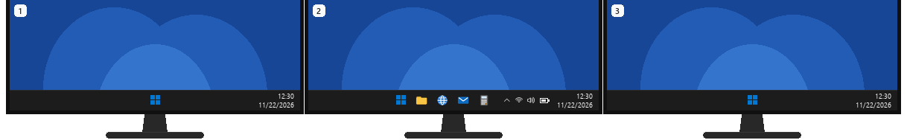
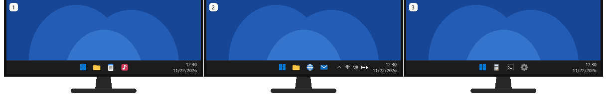

# Independent taskbar per monitor

A [Windhawk](https://windhawk.net) mod: **each taskbar behaves like its own main taskbar.**

| Without the mod | With the mod |
|:---:|:---:|
|  |  |

The pictures show: pinned items only, windows grouped and ungrouped, with and without labels,
dragging a window to another monitor and pinning an app.

## Features

* Each taskbar shows only the windows of its own monitor.
* Pin/unpin from the jump list applies to that taskbar only.
* Pin *Properties* can differ per taskbar.
* Clicking the pin of a running app brings its window to the front (Shift+click or middle-click
  starts a new instance).
* Each taskbar keeps its own order of buttons, also after a restart. New windows are added at the end.
* Drag a pin to another taskbar to move it there.
* Settings in English, German, Russian, French and Spanish.

## Install

In Windhawk, search for **Independent taskbar per monitor** and click *Install*,
or open the [catalog page](https://windhawk.net/mods/taskbar-independent-per-monitor).

Requires 64-bit Windows 10 or Windows 11 and *Show my taskbar on all displays*.
Tested with *Combine taskbar buttons: Never*.

## Settings

| Section | Setting | Default |
|---|---|---|
| Windows | Which windows each taskbar shows | Only the windows of its own monitor |
| Windows | Programs on all taskbars | none |
| Pins | Mode | Separate for each taskbar |
| Pins | Pins without an assigned taskbar | Primary taskbar only |
| Pins | Show apps on all taskbars | on |
| Click | Bring running apps to the front | on |
| Click | Windows that are brought to the front | Windows on any monitor |
| Click | Open apps on the clicked taskbar's monitor | on |
| Animation | Slide when a window moves to another monitor (Windows 11) | on |

## Compatibility

Other mods that change the taskbar buttons may get in the way. Please check the combination
yourself, there is no guarantee.

With *Disable grouping on the taskbar*, pinning from a window button pins the app's Start menu
shortcut. This is a temporary workaround for
[a bug in that mod](https://github.com/ramensoftware/windhawk-mods/issues/7900); existing pins are
not changed.

## Other languages

 Deutsch

Jede Taskleiste verhält sich wie eine eigene Haupt-Taskleiste.

Die Bilder zeigen: nur Pins, Fenster gruppiert und einzeln, mit und ohne
Beschriftung, ein Fenster auf einen anderen Monitor ziehen und eine App anheften.

* Jede Taskleiste zeigt nur die Fenster ihres eigenen Monitors.
* Anheften/Lösen über die Sprungliste gilt nur für diese Taskleiste.
* Die *Eigenschaften* eines Pins können je Taskleiste verschieden sein.
* Ein Klick auf den Pin einer laufenden App holt ihr Fenster nach vorn
  (Umschalt+Klick oder Mittelklick startet eine neue Instanz).
* Jede Taskleiste behält ihre eigene Reihenfolge, auch nach einem Neustart.
  Neue Fenster kommen ans Ende.
* Einen Pin auf eine andere Taskleiste ziehen, um ihn dorthin zu verschieben.

Benötigt 64-Bit-Windows 10 oder Windows 11 und *Taskleiste auf allen Anzeigen
anzeigen*. Getestet mit *Taskleistenschaltflächen zusammenfassen: Nie*.

Hinweis: Andere Mods, die die Taskleisten-Schaltflächen ändern, können sich in
die Quere kommen. Bitte die Kombination selbst prüfen, keine Garantie.

Mit *Disable grouping on the taskbar* heftet das Anheften über einen Fenster-Button
die Startmenü-Verknüpfung der App an. Das ist eine vorübergehende Umgehung für
[einen Fehler in dieser Mod](https://github.com/ramensoftware/windhawk-mods/issues/7900); vorhandene Pins bleiben unverändert.

 Русский

Каждая панель задач работает как отдельная главная панель.

На картинках: только закреплённые значки, окна сгруппированные и по отдельности,
с подписями и без, перетаскивание окна на другой монитор и закрепление приложения.

* Каждая панель задач показывает только окна своего монитора.
* Закрепление/открепление через список переходов действует только для этой
  панели.
* *Свойства* закреплённого значка могут различаться для каждой панели.
* Щелчок по значку запущенного приложения выводит его окно на передний план
  (Shift+щелчок или щелчок средней кнопкой запускает новый экземпляр).
* Каждая панель сохраняет свой порядок кнопок, в том числе после перезапуска.
  Новые окна добавляются в конец.
* Перетащите закреплённый значок на другую панель, чтобы переместить его туда.

Требуется 64-разрядная Windows 10 или Windows 11 и параметр *Показывать панель
задач на всех дисплеях*. Проверено с *Группировать кнопки на панели задач:
Никогда*.

Примечание: другие моды, изменяющие кнопки панели задач, могут мешать работе.
Проверьте сочетание сами, гарантии нет.

С модом *Disable grouping on the taskbar* закрепление через кнопку окна закрепляет
ярлык приложения из меню «Пуск». Это временное решение [ошибки в том моде](https://github.com/ramensoftware/windhawk-mods/issues/7900);
существующие закрепления не изменяются.

 Français

Chaque barre des tâches se comporte comme sa propre barre principale.

Les images montrent : éléments épinglés seuls, fenêtres regroupées ou séparées,
avec et sans étiquettes, déplacement d'une fenêtre vers un autre écran et
épinglage d'une application.

* Chaque barre des tâches n'affiche que les fenêtres de son propre écran.
* Épingler/désépingler depuis la liste de raccourcis ne s'applique qu'à cette
  barre.
* Les *Propriétés* d'un élément épinglé peuvent différer selon la barre.
* Un clic sur l'élément épinglé d'une application en cours ramène sa fenêtre au
  premier plan (Maj+clic ou clic du milieu lance une nouvelle instance).
* Chaque barre conserve son propre ordre de boutons, même après un redémarrage.
  Les nouvelles fenêtres sont ajoutées à la fin.
* Faites glisser un élément épinglé vers une autre barre pour l'y déplacer.

Nécessite Windows 10 ou Windows 11 64 bits et *Afficher ma barre des tâches sur
tous les écrans*. Testé avec *Combiner les boutons de la barre des tâches :
Jamais*.

Remarque : d'autres mods qui modifient les boutons de la barre des tâches peuvent
gêner. Vérifiez la combinaison vous-même, sans garantie.

Avec *Disable grouping on the taskbar*, épingler depuis le bouton d'une fenêtre épingle
le raccourci du menu Démarrer de l'application. C'est une solution temporaire à
[un bug de ce mod](https://github.com/ramensoftware/windhawk-mods/issues/7900) ; les épingles existantes ne sont pas modifiées.

 Español

Cada barra de tareas funciona como su propia barra principal.

Las imágenes muestran: solo elementos anclados, ventanas agrupadas y separadas,
con y sin etiquetas, arrastrar una ventana a otro monitor y anclar una aplicación.

* Cada barra de tareas muestra solo las ventanas de su propio monitor.
* Anclar/desanclar desde la lista de accesos directos solo se aplica a esa barra.
* Las *Propiedades* de un elemento anclado pueden ser distintas en cada barra.
* Al hacer clic en el elemento anclado de una aplicación en ejecución, su ventana
  pasa al frente (Mayús+clic o clic central abre una nueva instancia).
* Cada barra conserva su propio orden de botones, también tras reiniciar. Las
  ventanas nuevas se añaden al final.
* Arrastra un elemento anclado a otra barra para moverlo allí.

Requiere Windows 10 u 11 de 64 bits y *Mostrar mi barra de tareas en todas las
pantallas*. Probado con *Combinar botones de la barra de tareas: Nunca*.

Nota: otros mods que cambian los botones de la barra de tareas pueden interferir.
Comprueba la combinación tú mismo, sin garantía.

Con *Disable grouping on the taskbar*, anclar desde el botón de una ventana ancla el
acceso directo del menú Inicio de la aplicación. Es una solución temporal para
[un error de ese mod](https://github.com/ramensoftware/windhawk-mods/issues/7900); los anclajes existentes no se modifican.

## Report a bug

Please open an issue in the [Windhawk mods repository](https://github.com/ramensoftware/windhawk-mods/issues/new?template=bug_report.md&title=%5BIndependent%20taskbar%20per%20monitor%5D%20).

## Changelog

See [CHANGELOG.md](CHANGELOG.md) (German) or the changelog on the
[catalog page](https://windhawk.net/mods/taskbar-independent-per-monitor).

## License

[MIT](LICENSE)
